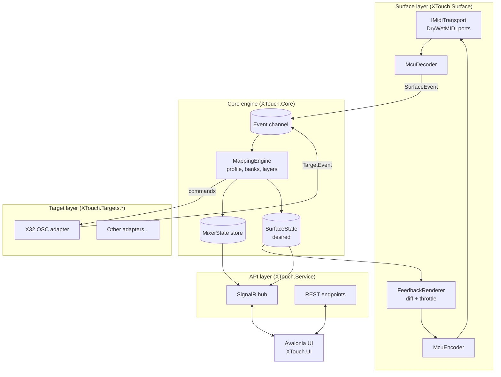
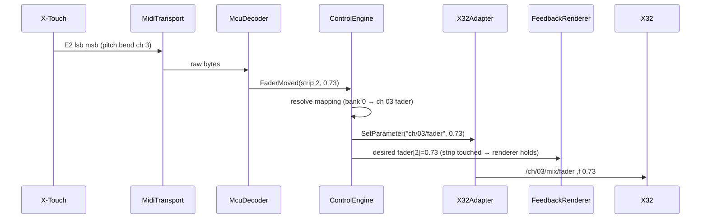

# 2. Architecture

> **⚙ Reconcile** — If your architecture files already define layers or project
> names, map them onto the layers below; the responsibilities and the
> threading rules (§2.4) are the parts worth keeping regardless of naming.

## 2.1 Layered view



**Key idea:** the engine never writes MIDI directly. It updates a *desired
surface state* (what each fader/LED/LCD *should* show). A separate
`FeedbackRenderer` diffs desired vs. last-sent state and emits only the changes,
rate-limited. This one decision solves echo suppression, bandwidth limits,
reconnect repaint and testability at once.

## 2.2 Solution layout

```
XTouchMiddleware.sln
├─ src/
│  ├─ XTouch.Abstractions/     # Interfaces + records shared by every project (no deps)
│  │    SurfaceEvents.cs, ControlIds.cs, ITargetAdapter.cs, IMidiTransport.cs
│  ├─ XTouch.Surface/          # MCU protocol: decoder, encoder, renderer, transports
│  │    Mcu/McuDecoder.cs, Mcu/McuEncoder.cs, Mcu/McuConstants.cs
│  │    Transport/DryWetMidiTransport.cs, Transport/VirtualTransport.cs
│  │    FeedbackRenderer.cs, SurfaceState.cs
│  ├─ XTouch.Core/             # Engine: mapping, banking, layers, state store
│  │    Engine/ControlEngine.cs, Mapping/*, State/MixerState.cs, Profiles/*
│  ├─ XTouch.Targets.X32/      # Reference adapter (OSC/UDP)
│  ├─ XTouch.Targets.Midi/     # Generic MIDI target (DAW, etc.)
│  ├─ XTouch.Service/          # Host: DI, workers, SignalR hub, REST, Program.cs
│  ├─ XTouch.Contracts/        # DTOs shared by Service and UI (API surface only)
│  └─ XTouch.UI/               # Avalonia desktop app
└─ tests/
   ├─ XTouch.Surface.Tests/
   ├─ XTouch.Core.Tests/
   ├─ XTouch.Targets.X32.Tests/
   └─ XTouch.IntegrationTests/  # Service + virtual surface + fake target
```

Dependency rules (enforce with project references only — no cycles):

```
Abstractions ◄── Surface ◄──┐
Abstractions ◄── Core    ◄──┼── Service ──► Contracts ◄── UI
Abstractions ◄── Targets ◄──┘
```

`XTouch.UI` **never** references Core/Surface; it only knows `Contracts` and talks
over the network. That keeps the UI optional and lets the service run headless.

## 2.3 Data flow

### Input path (operator moves fader 3)



### Feedback path (someone changes channel 3 on the mixer)

```mermaid
sequenceDiagram
    participant X32
    participant AD as X32Adapter
    participant EN as ControlEngine
    participant FR as FeedbackRenderer
    participant XT as X-Touch
    X32->>AD: /ch/03/mix/fader ,f 0.50
    AD->>EN: ParameterChanged("ch/03/fader", 0.50)
    EN->>EN: update MixerState; is ch 3 visible in bank? → strip 2
    EN->>FR: desired fader[2]=0.50
    FR->>XT: E2 lsb msb (next render tick, if not touched)
```

## 2.4 Threading model

| Thread / task | Owns | Rule |
|---------------|------|------|
| MIDI driver callback | nothing | Decode and `TryWrite` to the event channel. Never block, never touch state. |
| Target receive loop(s) | its socket | Parse and `TryWrite` to the event channel. |
| **Engine loop** (single reader) | `MixerState`, `SurfaceState`, mapping, banks | The *only* code that mutates state. No locks needed. |
| Render loop (timer, ~100 Hz) | last-sent snapshot | Reads desired state snapshot, diffs, sends MIDI. |
| Meter loop (~15 Hz) | meter cache | Sends meter values (they decay on the device and must be refreshed). |
| ASP.NET Core / SignalR | — | Reads immutable snapshots; mutations go through the event channel as commands. |

All inputs (surface, targets, UI commands, timers) are funneled into one
`System.Threading.Channels.Channel<EngineInput>`. This **actor-style single
writer** design removes race conditions such as "UI changes bank while a fader
is moving".

## 2.5 Extension points

| Interface | Purpose | Example implementations |
|-----------|---------|------------------------|
| `IMidiTransport` | Raw byte I/O to a surface | DryWetMIDI USB, RTP-MIDI, virtual (tests) |
| `ISurfaceProtocol` | Bytes ⇄ `SurfaceEvent`/feedback | MCU (X-Touch, Extender), X-Touch Compact CC map, HUI |
| `ITargetAdapter` | Talk to a target | X32/M32 OSC, Wing OSC, generic MIDI, VoiceMeeter API |
| `IValueConverter` | Normalized 0–1 ⇄ target units | Linear, dB taper, pan −100..100, on/off |

## 2.6 State model

```csharp
// Target side: what the mixer looks like (keyed by adapter-specific address)
public sealed class MixerState
{
    private readonly Dictionary<ParameterAddress, ParameterValue> _values = new();
    public ParameterValue? Get(ParameterAddress a) => _values.GetValueOrDefault(a);
    public bool Set(ParameterAddress a, ParameterValue v) { /* returns true if changed */ }
}

// Surface side: what the X-Touch SHOULD look like right now
public sealed class SurfaceState
{
    public double[] Faders { get; } = new double[9];          // 0..1
    public bool[] FaderTouched { get; } = new bool[9];
    public LedState[] Leds { get; } = new LedState[128];      // indexed by MCU note
    public RingState[] Rings { get; } = new RingState[8];
    public string[] LcdTop { get; } = new string[8];          // 7 chars each
    public string[] LcdBottom { get; } = new string[8];
    public LcdColor[] LcdColors { get; } = new LcdColor[8];
    public int[] Meters { get; } = new int[8];                // 0..12 (MCU meter steps)
    public string Display { get; set; } = "";                 // 12-char 7-seg
}
```

`SurfaceState`, its immutable `SurfaceSnapshot` and the `IFeedbackSink`
interface belong in `XTouch.Abstractions`, so Core can produce snapshots and
Surface can render them without referencing each other.

Both are mutated only by the engine loop; the renderer and the API receive
copies (`SurfaceSnapshot`, `MixerSnapshot`) published after each engine batch.
